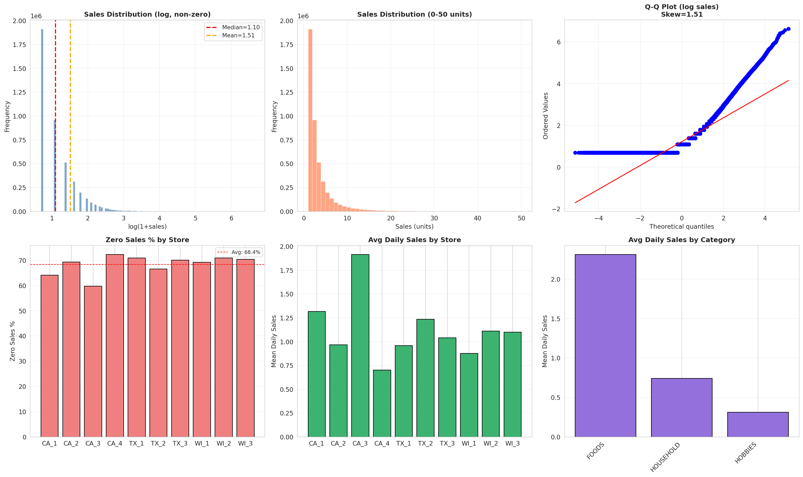
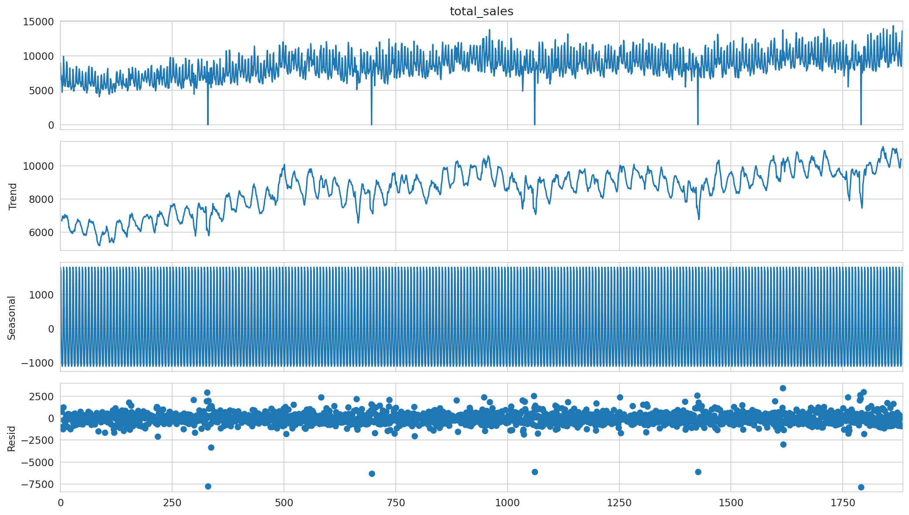

<div align="center">

# M5 Sales Forecasting

**One global gradient-boosting model that forecasts 28 days of Walmart sales for 30,490 product × store series, on a single 30 GB Kaggle notebook.**

     

[Highlights](#highlights) · [Self-audit](#what-i-found-when-i-audited-my-own-pipeline) · [Pipeline](#pipeline) · [Data](#data) · [Results](#results) · [How to run](#how-to-run) · [Limitations](#known-limitations)

</div>

---

## Highlights

| 🧠 Modelling | ⚙️ Engineering | 🔍 Evaluation |
|---|---|---|
| One global model for all 30,490 series with 44 features; an ensemble of 4 LightGBM objectives (Tweedie 1.1 / 1.5, Poisson, RMSE) and XGBoost (Tweedie 1.1), weighted by inverse validation RMSE | 59M rows on a 30 GB machine: chunked CSV → Snappy Parquet, features streamed column by column into `np.memmap`, 40% row sample (22.6M rows), GPU first with CPU fallback | Recursive 28-day forecast with real sales hidden, the same way the test period is forecast; four leakage and evaluation bugs found and fixed in a self-audit |

## At a glance

| | |
|---|---|
| **Problem** | Daily sales of 3,049 products in 10 stores (CA, TX, WI). About 68% of product-days have zero sales, so demand is intermittent and heavily skewed |
| **Model** | One global model for all 30,490 series, 44 features, 5-model ensemble |
| **Forecasting** | Recursive: forecast day *d*, then feed that forecast into the lag and rolling features of day *d + 1*, for 28 days |
| **Evaluation** | The 28 validation days are forecast recursively with their real sales hidden |
| **Status** | Leakage and evaluation bugs found in review are fixed (see below). The notebook is being re-run; scores will be added here when it finishes |

## What I found when I audited my own pipeline

My first version reported a bottom-level WAPE of about 42.6% on validation. When I reviewed the code I found that this number could not be trusted, for four reasons:

| Problem | Evidence | Fix |
|---|---|---|
| **Target leakage in `zero_streak`.** The feature counted the target day's own sales, so a value of 0 meant "this item sold something today" | It was the strongest feature by gain (3.3e8, 2.6× the next one) | Count zero-sales days up to **yesterday** only |
| **Validation was a 1-day-ahead score.** Validation lags were built from the real validation sales, while the test period has to be forecast 28 days ahead | Recursive test forecasts averaged 0.26 to 0.34 units per series-day, against about 1.12 in history | Hide validation sales and forecast all 28 days recursively, exactly like test |
| **Two prediction arrays blended in different row orders.** One was ordered series-then-day, the other day-then-series | The 50/50 blend mixed values from different series and days | Remove the blend; save every forecast together with its series id and day |
| **Same-day aggregate features.** Store / department / category / global means of the *same day's* sales were features, but they are unknown at forecast time (0 on test days) | Train/test mismatch | Drop them; `item_gmean` now uses training rows only |

The fix is in [PR #1](https://github.com/bichtram3010/forecast_timeseries/pull/1).

> [!TIP]
> **Lesson learned:** for time series, judge a model by a score computed exactly the way it will be used, and treat any surprisingly dominant feature as a leakage suspect until proven otherwise.

## Pipeline


Everything lives in one notebook, [`timeseries-forecast (1).ipynb`](timeseries-forecast%20(1).ipynb):

| Cell | Step | Output |
|:---:|---|---|
| 0 | `pip install` | |
| 1 | EDA: streams the training data and draws 14 figures | `figures/`, `output/eda_summary.csv` |
| 2 | Data prep: chunked CSV to Parquet, feature engineering, memmaps | `mmap/` |
| 3 | Train LightGBM (Tweedie 1.1) and XGBoost (Tweedie 1.1) | `models/lgb.txt`, `models/xgb.json` |
| 4 | Train LightGBM with Tweedie 1.5, Poisson and RMSE objectives, compute ensemble weights | `models/`, `preds/ensemble_weights.json` |
| 5 | Recursive forecast: 28 validation days (scored) and 28 test days | `output/metrics_recursive_val.csv`, `output/submission_recursive.csv` |
| 6 | Hierarchical reconciliation toward state-level totals (experimental) | `output/submission_reconciled.csv` |

Cells 3 and 4 also print a *one-step* validation score (true sales as lag inputs). That score is only used for early stopping and ensemble weights, not for reporting.

<details>
<summary><b>Features (44)</b></summary>

| Group | Features |
|---|---|
| Calendar | `wday`, `month`, `year`, `quarter`, `is_weekend`, `day_of_month`, `is_payday` |
| Events and SNAP | `event_type_1_enc`, `event_type_2_enc`, `has_event`, `snap_CA/TX/WI` and their interactions with events and weekday |
| Price | `sell_price`, `price_ratio`, `price_norm` |
| IDs (label-encoded) | series, item, department, category, store, state |
| Sales history (up to yesterday only) | `lag_1/7/14/28`, `rmean_7/14/28`, `rstd_28`, `rmax_7`, `ewm_01`, `ewm_05`, `lag1_diff`, `trend_7`, `zero_streak` |
| Item level | `item_gmean` (training rows only), `vs_item` |

The full ordered list is in [`mmap/feature_cols.json`](mmap/feature_cols.json).

</details>

## Data

**M5 Forecasting - Accuracy** (Walmart): 3,049 items, 10 stores in 3 states, 3 categories, 7 departments, 30,490 bottom-level series, 1,941 days (1,885 train, 28 validation, 28 test).

| | |
|---|---|
| **Intermittent demand.** Most product-days sell nothing, and the non-zero sales are heavily right-skewed | **Weekly seasonality and a slow upward trend.** Stores close on Christmas Day (the drops to zero) |
|  |  |

*Both figures come from a random row sample of the training data, so levels are lower than the full totals. More EDA figures are in [`figures/`](figures/).*

## Results

> [!NOTE]
> **Pending re-run.** The 28-day recursive validation scores (MAE, RMSE, WAPE, bias per model and for the ensemble) will be written to `output/metrics_recursive_val.csv` and added here.

<details>
<summary>Old numbers from the leaky pipeline (do not use)</summary>

These came from the first version, before the fixes above. They are one-step scores with a leaking feature, so they overstate accuracy.

| Model | MAE | RMSE | WAPE % | Bias % |
|---|---|---|---|---|
| LightGBM, Tweedie 1.1 | 0.5924 | 1.6533 | 42.73 | +1.11 |
| LightGBM, Tweedie 1.5 | 0.5908 | 1.6509 | 42.62 | +0.94 |
| LightGBM, Poisson | 0.5950 | 1.6774 | 42.91 | +1.36 |
| LightGBM, RMSE | 0.6151 | 1.6727 | 44.37 | +2.70 |
| XGBoost, Tweedie 1.1 | 0.5906 | 1.6571 | 42.60 | +0.91 |
| Ensemble (LGB + XGB) | 0.5907 | 1.6494 | 42.61 | +1.01 |
| Ensemble (5 models) | 0.5953 | 1.6508 | 42.93 | +1.40 |

</details>

## How to run

1. Create a Kaggle notebook with about 30 GB of RAM (a GPU is optional).
2. Attach a dataset with the M5 data as `train.csv`, `val.csv`, `test.csv` (one row per series and day), and set `DATA_DIR` in cells 1 and 2.
3. Start from an empty `/kaggle/working/` and run the cells in order. Cells 3 and 4 skip training when model and prediction files already exist, so files from an older run would be reused.

| Step | Approx. wall time (previous run) |
|---|---|
| Cell 3, training | ~30 min |
| Cell 4, training | ~70 min |
| Cell 5, recursive forecast | ~36 min (estimated) |
| Cell 6, reconciliation | < 1 min |

## Repository layout

```text
.
├── timeseries-forecast (1).ipynb   # the whole pipeline (cells 0-6)
├── figures/                        # 14 EDA figures from cell 1
├── mmap/feature_cols.json          # ordered list of the 44 model features
├── output/eda_summary.csv          # EDA summary (see known limitations)
└── LICENSE
```

## Known limitations

- **No scores yet** after the fixes; see [Results](#results).
- Early stopping and ensemble weights use the one-step score on the same validation block that is later scored recursively, so the recursive score can still be slightly optimistic.
- The reconciliation in cell 6 uses a simple weekday-profile average for the state totals, not a trained model; it needs to be checked again once the bottom-level forecasts are fixed.
- The EDA cell has known aggregation bugs: event lift 0%, SNAP impact N/A, date coverage 2.52% and 1.0 stores per item in `output/eda_summary.csv` are wrong (they also show up in some panels of `figures/03`, `06` and `08`), and its sample is much larger than intended.
- Hard-coded Kaggle paths, everything in one notebook, no pinned dependencies.

## Next steps

- [ ] Re-run and publish the recursive validation scores, compared with a seasonal-naive baseline
- [ ] Report WAPE at total, state and store level, and the official M5 metric (WRMSSE)
- [ ] Fix the EDA aggregation bugs and the reconciliation step
- [ ] Split the notebook into scripts and add `requirements.txt`

## License

GPL-3.0, see [LICENSE](LICENSE).
